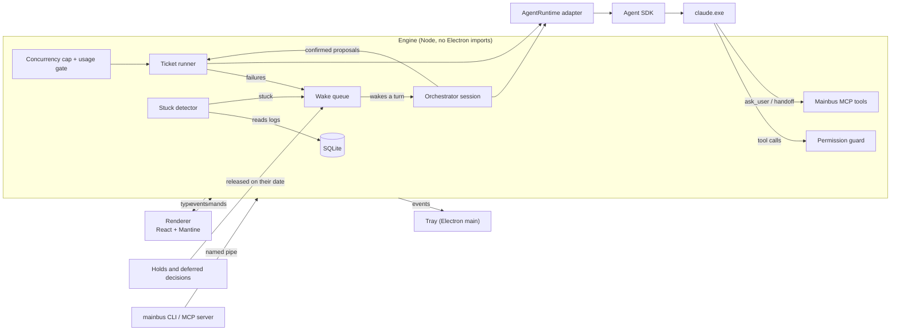

# Mainbus

A local desktop app for running AI coding agents against a ticket board. You write a ticket, and a lineup of Claude Code agents takes it from plan to reviewed branch. Mainbus records the work in a thread you can read, turns anything an agent wants to do outside its lane into a card you answer, notices when an agent gets stuck, and stops at Review for you to merge.

Since its MVP, Mainbus has been built by Mainbus: each feature after that is a ticket on its own board, worked by its own agents, and merged as a pull request.

The name comes from the "main bus" pattern in Factorio: one central line that feeds every production line.

## What it does

- **A board per repository.** The columns are Backlog, Ready, In progress, Needs you, Review and Done. Cards show the ticket and its phase, never tokens or timers. Several repositories can be open at once, each as a workspace with its own board.
- **One git worktree per ticket.** Each ticket gets its own branch (`mainbus/<n>-<slug>`) and a worktree in Mainbus's data folder, outside your repo. Agents never touch your checkout, and several tickets can run side by side. Moving a ticket to Done removes the worktree, but never one with uncommitted work.
- **Lineups of role agents.** The default lineup is Planner → Implementer → Reviewer, and each workspace can reorder, add or edit roles. A second lineup, for Investigate tickets, has one read-only Investigator. Each role is a fresh agent that hands off to the next one with a summary. A Reviewer can hand work back to the Implementer, up to three round trips, after which the ticket comes to you.
- **Your words are the acceptance bar.** The ticket's intent is kept verbatim and given to every role as the standard it may not widen. Anything beyond it has to come back to you as a question.
- **Questions and permissions as cards.** Agents ask through a Mainbus tool rather than a terminal prompt, and anything that needs approval shows as a card with Allow once, Always allow in this workspace, or Deny. The ticket moves to Needs you until you answer.
- **One decision, three places.** An open question shows on the board card, in the orchestrator panel and inline in the ticket's thread, and answering it in any one of them resolves all three. **Later…** defers a decision until a date, when it comes back. A ticket can be put on hold, optionally until a date, and is released automatically when that date arrives.
- **An orchestrator beside the board.** A docked panel holds one read-only Claude Code session for all workspaces. It can see every board and read each workspace's repository and ticket folders. Ask it in plain words and it drafts tickets with your words kept as the intent, proposes starting, pausing or holding tickets, picks a model and effort for each role, and recommends answers to open decisions, flagging the ones that need your judgement. Each proposal is a card you confirm or override, and Mainbus, not the model, carries it out.
- **Stuck agents are noticed and recovered.** Once a minute, a detector checks every running agent's log and worktree for a stuck pattern:
  - the same command failing 5 times in a row;
  - 15 minutes without a file change or a new kind of tool;
  - 10 minutes without a single event;
  - one turn running over an hour;
  - an agent process that has ended.

  An agent that is still changing files, or has declared a wait, isn't stuck. Each stuck episode raises one alert rather than a stream of them. Recovery goes up a ladder:
  1. **Redirect:** one corrective message to the agent.
  2. **Replace:** a fresh agent for the same role, which starts from a generated summary of the previous run.
  3. **Failed:** after two replacements, the ticket comes to you.

  The orchestrator proposes each step as a card. The **Replace…** button in the ticket view offers a replacement at any time. The thread marks where the replacement took over, and **View previous run** opens the old run read-only.
- **The orchestrator wakes itself.** It takes a turn without being asked when something needs a judgement call:
  - a ticket's agent failed;
  - an agent looks stuck;
  - a hold ran out on its date (releasing a hold by hand doesn't wake it);
  - a deferred decision came back.

  Wakes are batched over a few seconds, and any that were unanswered when Mainbus closed are presented again on the next launch.
- **Restart recovery.** On launch, Mainbus first ends any processes a crash left behind. Agents that were working are resumed by themselves with "Mainbus restarted; continue where you left off." Paused runs, runs waiting on a decision, runs stopped by a usage limit and queued runs stay as they were. If a ticket's folder is gone, the ticket gets a question, **Recreate the folder from the branch and continue** or **Stop the run**, rather than restarting somewhere else. Pending permission cards expire, unfinished cleanups are completed, and holds that came due while Mainbus was closed are released.
- **A concurrency cap.** **Agents running at once** (1–10, default 3, one setting for the whole app) limits how many role agents work together. The rest show as **Queued** and start first in, first out. A handoff keeps its slot, the orchestrator doesn't count, and lowering the cap stops nothing that is running.
- **Usage limits for the whole fleet.** When Claude's usage limit is hit, every working agent is paused, and a banner reads "Usage limit reached. N agents paused; resuming at …" with a **Resume now** button. At the reset the agents resume in order, within the cap. At 90% used, the banner warns that new agents wait until the reset, and they show as Queued.
- **Investigate tickets.** A ticket of the Investigate kind runs the read-only Investigator, which ends with `submit_report` instead of a handoff. The report is the result and the ticket stops at Review. **Promote** (from the ticket view or an orchestrator card, once, from Review or Done) turns the report into a new Change ticket in Ready, with its spec drafted from the report, and moves the investigation to Done.
- **Multiple workspaces.** A rail beside the board lists every workspace with how many agents are working or waiting on you. **+ Add workspace** picks a repository folder, and **Options → Remove…** takes one off the rail. Each workspace keeps its own board, lineup, rules and unattended switch.
- **Find things and see what changed.** The search box (**Ctrl+K**) finds `#12` exactly, or any text in a title, label or the words you wrote. A card Mainbus just changed gets a blue outline that fades over a few seconds, or shows briefly without fading when reduced motion is on. Empty boards and empty panels say what to do next.
- **The tray and notifications.** Closing the window while agents are open hides Mainbus to the tray, and they keep working. The tray menu opens the app, shows what needs you and quits, and the tooltip and taskbar badge count the tickets that need you. When the window is hidden or unfocused, a notification says which tickets reached Needs you or Review.
- **Accessible by keyboard and screen reader.** The core flow works from the keyboard alone, targets are at least 44 px, and animation respects the system's reduced-motion setting.
- **Unattended mode.** Per workspace, and remembered across restarts. Mainbus starts the lowest-numbered Ready ticket that isn't held, one at a time, and waits when Ready is empty. It keeps the machine awake while it works.
- **Pull requests at Review.** Optionally, Mainbus pushes the branch and opens a PR through the GitHub CLI when the last role hands off.
- **Agents can file tickets.** The `mainbus` CLI and an MCP server let a Claude Code session in another terminal create, list and read tickets on the running board. A ticket is filed into the workspace that contains the caller's folder (its repository or one of its ticket folders), and is refused if none does. New tickets always land in Backlog for you to review.

## How the agents are run

Mainbus drives the official, unmodified `claude` binary through the [Claude Agent SDK](https://www.npmjs.com/package/@anthropic-ai/claude-agent-sdk), so Claude Code handles its own login and Mainbus never handles credentials. Each agent is one long-lived, headless, streaming session. Its events are normalized into a typed stream, stored in SQLite, and rendered as the ticket's thread.



Mainbus's guiding rule is that **state lives on disk and code owns the mechanics; the models only make judgement calls.** In practice:

- **A small role protocol instead of free-form control.** Every role gets the same few Mainbus tools:
  - `ask_user` opens a decision and ends the agent's turn;
  - `handoff` passes the ticket to the next role;
  - `submit_report` ends an Investigate ticket's last role with its report, instead of a handoff (a role gets one or the other);
  - `report_problem` hands back to an earlier role or asks you;
  - `check_criterion` ticks an acceptance criterion the agent has verified;
  - `report_waiting` declares a legitimate wait of up to two hours, such as a slow build, so the stuck detector doesn't take the silence for being stuck.

  The engine, not the model, moves the ticket between columns.
- **Launch hardening.** Agents can't use the built-in question tool, subagents, their own worktrees, scheduling tools, the Monitor tool or background commands (long commands run in the foreground, up to 30 minutes), so every question and every piece of work goes through Mainbus's records. They load only the repository's own Claude settings, never the user's global ones. The system prompt draws a trust boundary: the ticket and Mainbus's messages are instructions, while files, tool output and web pages are data.
- **A nudge, then a stop.** A turn that ends without a handoff, a question or a reported problem gets one nudge. A second one in a row marks the agent Failed and brings the ticket to you. "Same obstacle twice" means stop and report, not retry.
- **Replaceable runtime.** The engine talks to agents only through an `AgentRuntime` interface. A scripted fake runtime implements the same interface for tests.

## Safety model

Agents run in Claude Code's accept-edits mode inside the ticket's worktree. Edits there go through; anything else reaches Mainbus's permission callback and becomes a card. "Always allow" rules live in Mainbus's database, never in `.claude/settings.local.json`, where an agent might commit them.

On top of that, a **guard** runs before the allow list and sends these to a card even if a broad rule would match:

- **Hard stops,** which always wait for you:
  - any push;
  - reading credential files;
  - writing or working outside the ticket's folder and its scratch folder;
  - touching `~/.claude` or agent and git settings;
  - deleting or renaming other branches, dropping stashes, pruning git objects;
  - changing git or npm config.
- **Lower-risk reasons,** which unattended mode may allow on its own:
  - reads outside the ticket's folder;
  - discarding work inside the ticket's own worktree;
  - commands the guard can't check.

The guard parses the command lines of the Bash and PowerShell tools, including chains, redirects, interpreters and cmd builtins, and it errs towards asking. A target it can't resolve, such as a path held in a variable, counts as outside. The guard was added after the first spike showed that the CLI's automatic permission mode would allow a force-push and file deletion outside the working folder when the prompt implied it.

Other boundaries:

- Agents see `MAINBUS_AGENT` in their environment. The CLI and the build scripts refuse to file tickets on, or replace, the board that is running them.
- The stable build, development runs and tests each use a separate data home, so testing a branch can't touch the real board.
- The database is backed up before every schema migration.

## How it's built

Mainbus is an experiment in building software with AI agents. That includes using agents to build the tool that runs agents.

1. **Design first.** The product was worked out in conversation and written up as a [design document](docs/superpowers/specs/2026-10-30-mainbus-design.md). It covers goals, non-goals and anti-goals (failures even if the software technically works), with every decision recorded and calls made without the user marked as such.
2. **Spike the assumptions.** Before any product code, a throwaway [spike](docs/spikes/2026-10-30-m0-results.md) tested each assumption the design rested on, on the target machine. Several findings changed the design:
   - the permission guard, after auto mode proved too permissive;
   - SQLite through Node's built-in `node:sqlite`, with no native modules;
   - isolating agents from the user's global Claude settings;
   - dropping a planned background-session runtime.
3. **Build the smallest self-hosting version.** The [MVP](docs/superpowers/plans/2026-10-30-m1-mvp.md) was the least Mainbus that could finish a real Mainbus ticket: one role, worktrees, permission cards, and a stable build that survives the merges it produces.
4. **Then build Mainbus with Mainbus.** From [milestone 2](docs/superpowers/plans/2026-10-30-mainbus-roadmap.md) on, each change is a ticket on Mainbus's own board, worked by its agents, opened as a [pull request](https://github.com/artjumble/mainbus/pulls?q=is%3Apr), reviewed and merged. Rough edges found while using it go back on the board as tickets.

   For example, permission cards that fired when they didn't need to became four small tickets:
   - a read-only `git worktree list` no longer asks;
   - agents are steered to the Edit tool instead of `sed -i` loops;
   - each ticket gets its own scratch folder for temp files;
   - the guard recognises `$TEMP` as that folder.

   Each was written, tested and opened as a PR by the agents.

## Status

Mainbus is a personal tool: one user, one machine, Windows first. It runs on your own Claude subscription through the official CLI.

| Milestone | Scope | Built | State |
|---|---|---|---|
| M0 | Agent SDK spike | Directly | Done |
| M1 | Self-hosting MVP | Directly | Done |
| M2 | Lineups and handoffs | Through Mainbus | Done |
| M3 | Orchestrator agent that drafts and starts tickets | Through Mainbus | Done |
| M4 | Decisions in three places, holds and "Later" | Through Mainbus | Done |
| M5 | Stuck detection, Redirect and Replace | Through Mainbus | Done |
| M6 | Restart recovery, the orchestrator's wake queue, usage limits and a concurrency cap | Through Mainbus | Done |
| M7 | Investigate tickets, multiple workspaces, the tray and polish (search, empty states, accessibility, wireframe pass) | Through Mainbus | Done |

## Getting started

### Requirements

- Windows 11. Mainbus has only been built and run on Windows, and the stable build and the `mainbus` CLI launcher are PowerShell and `.cmd` scripts.
- Node.js 24 and Git.
- [Claude Code](https://docs.claude.com/en/docs/claude-code) on your PATH and signed in. Mainbus checks this at startup and never runs the login itself.
- Optional: the [GitHub CLI](https://cli.github.com/), signed in, to open pull requests at Review.

### Run it

```bash
npm install
npm run dev
```

`npm run dev` uses a development data home (`%LOCALAPPDATA%\Mainbus-dev`). Set `MAINBUS_HOME` to use another one. On the welcome screen, choose **+ Add workspace** and pick a repository folder, add a ticket, and drag it to Ready. Add more workspaces from the rail's **+ Add workspace** button. The gear in the board's header opens the settings, where the concurrency cap and the tray's close behaviour live, beside the lineup and pull request settings.

**The tray.** Closing the window while agents are open hides Mainbus to the tray, and the first time it says so in a notification. Closing it with no agents open quits. To always quit, set **When I close the window** to **Always quit** in the settings. Quit from the tray icon's menu to stop everything.

**Notifications and the Start Menu shortcut.** The packaged build (the stable build) keeps a Start Menu shortcut so Windows will show Mainbus's notifications. Development runs, tests and any run with `MAINBUS_HOME` set don't create one.

### The stable build

To work on Mainbus with Mainbus, run a built copy rather than the dev server, so merging a branch doesn't reload the app that is driving the agents:

```bash
npm run build:stable
npm run run:stable
```

`build:stable` installs the build under `%LOCALAPPDATA%\Mainbus\app`, keeps the three newest builds, and installs the `mainbus` CLI launcher in `%LOCALAPPDATA%\Mainbus\bin`. To go back to the build before the current one, run `scripts\run-stable.ps1 -Previous`.

### Let other agents file tickets

With the stable build running, register its MCP server with Claude Code (PowerShell):

```powershell
claude mcp add --scope user mainbus -- "$env:LOCALAPPDATA\Mainbus\bin\mainbus.cmd" mcp
```

Or use the CLI directly:

```powershell
$mainbus = "$env:LOCALAPPDATA\Mainbus\bin\mainbus.cmd"
& $mainbus ticket create --json ticket.json
& $mainbus ticket list --column review
& $mainbus ticket show 12
```

## Testing

```bash
npm run typecheck
npm test
npm run e2e
```

- **Unit tests** (Vitest, about 2,900 cases) cover the engine, the permission guard and shell parser, the stuck detector's rules, restart recovery, the concurrency queue, the CLI and intake protocol, and the React components, which are also checked with axe for accessibility. The SDK message normalizer is tested against messages recorded from real sessions during the spike.
- **End-to-end tests** (Playwright for Electron) build the app and drive it against throwaway repositories and a temporary data home. A scripted fake agent runtime asks questions, requests permissions, hands off and loops on a failing command, so the full flow runs without calling a model. A fake clock moves time forward for holds, deferred decisions, usage-limit resets and the stuck detector. Further end-to-end tests cover the whole app: a keyboard-only run of the core flow, an axe pass over every screen, and the artboard tests, which reproduce each wireframe artboard and save screenshots to `test-results/artboards/`.
- **By hand:** [the M5 stuck-recovery scenario](docs/manual/m5-stuck-recovery-by-hand.md) runs the same detect, redirect and replace sequence against a real `claude` agent.

## Project layout

```
src/
  engine/         the app's core, a plain Node module behind a typed command/event API
    runtime/      AgentRuntime: the Agent SDK adapter and the scripted fake
    runner/       runs tickets through their lineup, handoffs, decisions, unattended mode, the concurrency queue, usage limits and restart recovery
    orchestrator/ the orchestrator session, its read-only tools, prompt and wake queue
    proposals/    proposal kinds the user confirms: create, start, pause, hold, answer, redirect, replace, promote
    holds/        holds, deferred decisions and the clock that releases them
    stuck/        the stuck detector, its rules and the recovery ladder
    processes/    ends the processes an agent leaves running
    permissions/  the guard, shell parsing and allow-rule policy
    roles/        role prompts, the role protocol and launch hardening
    git/          worktrees, branches and pull requests
    intake/       the named-pipe server behind the CLI and MCP server
    state/        what each ticket is doing now, the lineup strip and the rail's counts
    tickets/      ticket validation and Promote
    store/, db/   SQLite through node:sqlite and Drizzle, with migrations
  main/           Electron main process
    tray/         the tray, its close behaviour, notifications and the Start Menu shortcut
  preload/        the bridge between the renderer and the engine
  renderer/       React UI built from Mantine components
  shared/         types and pure rules shared by the engine and the renderer
  cli/            the mainbus CLI and MCP server
e2e/              Playwright end-to-end tests and fake-runtime scripts
docs/             design, spike results, roadmap, plans and manual test runs
```

## Acknowledgements

Mainbus grew out of using [firstmate](https://github.com/kunchenguid/firstmate), a terminal-based setup where an orchestrator agent supervises coding agents. Its orchestrator and its approach to durability are the main reference for Mainbus's design. Appendix B of the design document lists what was borrowed and what was left out.

## License

Mainbus is released under the [MIT License](LICENSE). Copyright © 2026 artjumble.

Its dependencies keep their own licenses. The Claude Agent SDK, in particular, is covered by Anthropic's terms rather than MIT, and Mainbus doesn't include Claude Code itself: each user installs it and signs in to it.
