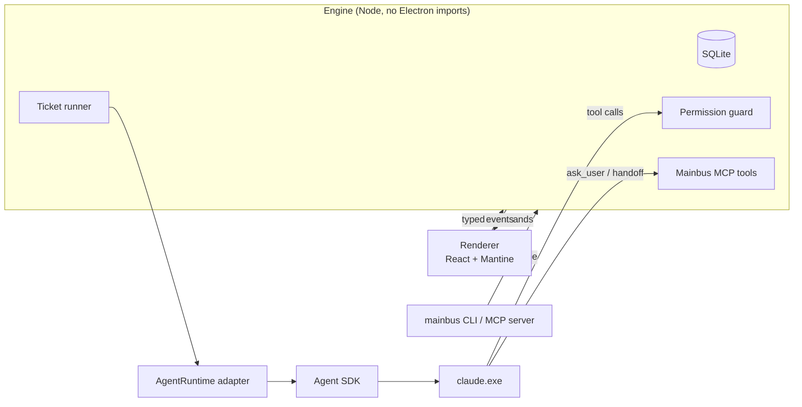

# Mainbus

A local desktop app for running AI coding agents against a ticket board. You write a ticket, and a lineup of Claude Code agents takes it from plan to reviewed branch. Mainbus records the work in a thread you can read, turns anything an agent wants to do outside its lane into a card you answer, and stops at Review for you to merge.

Since its MVP, Mainbus has been built by Mainbus: each feature after that is a ticket on its own board, worked by its own agents, and merged as a pull request.

The name comes from the "main bus" pattern in Factorio: one central line that feeds every production line.

## What it does

- **A board per repository.** The columns are Backlog, Ready, In progress, Needs you, Review and Done. Cards show the ticket and its phase, never tokens or timers.
- **One git worktree per ticket.** Each ticket gets its own branch (`mainbus/<n>-<slug>`) and a worktree in Mainbus's data folder, outside your repo. Agents never touch your checkout, and several tickets can run side by side. Moving a ticket to Done removes the worktree, but never one with uncommitted work.
- **Lineups of role agents.** The default lineup is Planner → Implementer → Reviewer, and each workspace can reorder, add or edit roles. Each role is a fresh agent that hands off to the next one with a summary. A Reviewer can hand work back to the Implementer, up to three round trips, after which the ticket comes to you.
- **Your words are the acceptance bar.** The ticket's intent is kept verbatim and given to every role as the standard it may not widen. Anything beyond it has to come back to you as a question.
- **Questions and permissions as cards.** Agents ask through a Mainbus tool rather than a terminal prompt, and anything that needs approval shows as a card with Allow once, Always allow in this workspace, or Deny. The ticket moves to Needs you until you answer.
- **Unattended mode.** Mainbus works through Ready one ticket at a time and waits when Ready is empty.
- **Pull requests at Review.** Optionally, Mainbus pushes the branch and opens a PR through the GitHub CLI when the last role hands off.
- **Agents can file tickets.** The `mainbus` CLI and an MCP server let a Claude Code session in another terminal create, list and read tickets on the running board. New tickets always land in Backlog for you to review.

## How the agents are run

Mainbus drives the official, unmodified `claude` binary through the [Claude Agent SDK](https://www.npmjs.com/package/@anthropic-ai/claude-agent-sdk), so Claude Code handles its own login and Mainbus never handles credentials. Each agent is one long-lived, headless, streaming session. Its events are normalized into a typed stream, stored in SQLite, and rendered as the ticket's thread.



Mainbus's guiding rule is that **state lives on disk and code owns the mechanics; the models only make judgement calls.** In practice:

- **A small role protocol instead of free-form control.** Every role gets the same few Mainbus tools:
  - `ask_user` opens a decision and ends the agent's turn;
  - `handoff` passes the ticket to the next role;
  - `report_problem` hands back to an earlier role or asks you;
  - `check_criterion` ticks an acceptance criterion the agent has verified.

  The engine, not the model, moves the ticket between columns.
- **Launch hardening.** Agents can't use the built-in question tool, subagents, their own worktrees or scheduling tools, so every question and every piece of work goes through Mainbus's records. They load only the repository's own Claude settings, never the user's global ones. The system prompt draws a trust boundary: the ticket and Mainbus's messages are instructions, while files, tool output and web pages are data.
- **A nudge, then a stop.** A turn that ends without a handoff, a question or a reported problem gets one nudge. A second one in a row marks the agent Failed and brings the ticket to you. "Same obstacle twice" means stop and report, not retry.
- **Replaceable runtime.** The engine talks to agents only through an `AgentRuntime` interface. A scripted fake runtime implements the same interface for tests.

## Safety model

Agents run in Claude Code's accept-edits mode inside the ticket's worktree. Edits there go through; anything else reaches Mainbus's permission callback and becomes a card. "Always allow" rules live in Mainbus's database, never in `.claude/settings.local.json`, where an agent might commit them.

On top of that, a **guard** runs before the allow list and sends these to a card even if a broad rule would match:

- **Hard stops,** which always wait for you:
  - any push;
  - reading credential files;
  - writing or working outside the ticket's folder and its scratch folder;
  - touching `~/.claude` or agent and git settings;
  - deleting or renaming other branches, dropping stashes, pruning git objects;
  - changing git or npm config.
- **Lower-risk reasons,** which unattended mode may allow on its own:
  - reads outside the ticket's folder;
  - discarding work inside the ticket's own worktree;
  - commands the guard can't check.

The guard parses the command lines of the Bash and PowerShell tools, including chains, redirects, interpreters and cmd builtins, and it errs towards asking. A target it can't resolve, such as a path held in a variable, counts as outside. The guard was added after the first spike showed that the CLI's automatic permission mode would allow a force-push and file deletion outside the working folder when the prompt implied it.

Other boundaries:

- Agents see `MAINBUS_AGENT` in their environment. The CLI and the build scripts refuse to file tickets on, or replace, the board that is running them.
- The stable build, development runs and tests each use a separate data home, so testing a branch can't touch the real board.
- The database is backed up before every schema migration.

## How it's built

Mainbus is an experiment in building software with AI agents. That includes using agents to build the tool that runs agents.

1. **Design first.** The product was worked out in conversation and written up as a [design document](docs/superpowers/specs/2026-10-30-mainbus-design.md). It covers goals, non-goals and anti-goals (failures even if the software technically works), with every decision recorded and calls made without the user marked as such.
2. **Spike the assumptions.** Before any product code, a throwaway [spike](docs/spikes/2026-10-30-m0-results.md) tested each assumption the design rested on, on the target machine. Several findings changed the design:
   - the permission guard, after auto mode proved too permissive;
   - SQLite through Node's built-in `node:sqlite`, with no native modules;
   - isolating agents from the user's global Claude settings;
   - dropping a planned background-session runtime.
3. **Build the smallest self-hosting version.** The [MVP](docs/superpowers/plans/2026-10-30-m1-mvp.md) was the least Mainbus that could finish a real Mainbus ticket: one role, worktrees, permission cards, and a stable build that survives the merges it produces.
4. **Then build Mainbus with Mainbus.** From [milestone 2](docs/superpowers/plans/2026-10-30-mainbus-roadmap.md) on, each change is a ticket on Mainbus's own board, worked by its agents, opened as a [pull request](https://github.com/artjumble/mainbus/pulls?q=is%3Apr), reviewed and merged. Rough edges found while using it go back on the board as tickets.

   For example, permission cards that fired when they didn't need to became four small tickets:
   - a read-only `git worktree list` no longer asks;
   - agents are steered to the Edit tool instead of `sed -i` loops;
   - each ticket gets its own scratch folder for temp files;
   - the guard recognises `$TEMP` as that folder.

   Each was written, tested and opened as a PR by the agents.

## Status

Mainbus is a personal tool: one user, one machine, Windows first. It runs on your own Claude subscription through the official CLI.

| Milestone | Scope | Built | State |
|---|---|---|---|
| M0 | Agent SDK spike | Directly | Done |
| M1 | Self-hosting MVP | Directly | Done |
| M2 | Lineups and handoffs | Through Mainbus | Done |
| M3 | Orchestrator agent that drafts and starts tickets | Through Mainbus | In Progress |
| M4 | Decisions in three places, holds and "Later" | Through Mainbus | Planned |
| M5 | Stuck detection, Redirect and Replace | Through Mainbus | Planned |
| M6 | Restart recovery, usage limits and a concurrency cap | Through Mainbus | Planned |
| M7 | Investigate tickets, multiple workspaces and polish | Through Mainbus | Planned |

## Getting started

### Requirements

- Windows 11. Mainbus has only been built and run on Windows, and the stable build and the `mainbus` CLI launcher are PowerShell and `.cmd` scripts.
- Node.js 24 and Git.
- [Claude Code](https://docs.claude.com/en/docs/claude-code) on your PATH and signed in. Mainbus checks this at startup and never runs the login itself.
- Optional: the [GitHub CLI](https://cli.github.com/), signed in, to open pull requests at Review.

### Run it

```bash
npm install
npm run dev
```

`npm run dev` uses a development data home (`%LOCALAPPDATA%\Mainbus-dev`). Set `MAINBUS_HOME` to use another one. Open a repository folder to create its workspace, add a ticket, and drag it to Ready.

### The stable build

To work on Mainbus with Mainbus, run a built copy rather than the dev server, so merging a branch doesn't reload the app that is driving the agents:

```bash
npm run build:stable
npm run run:stable
```

`build:stable` installs the build under `%LOCALAPPDATA%\Mainbus\app`, keeps the three newest builds, and installs the `mainbus` CLI launcher in `%LOCALAPPDATA%\Mainbus\bin`. To go back to the build before the current one, run `scripts\run-stable.ps1 -Previous`.

### Let other agents file tickets

With the stable build running, register its MCP server with Claude Code (PowerShell):

```powershell
claude mcp add --scope user mainbus -- "$env:LOCALAPPDATA\Mainbus\bin\mainbus.cmd" mcp
```

Or use the CLI directly:

```powershell
$mainbus = "$env:LOCALAPPDATA\Mainbus\bin\mainbus.cmd"
& $mainbus ticket create --json ticket.json
& $mainbus ticket list --column review
& $mainbus ticket show 12
```

## Testing

```bash
npm run typecheck
npm test
npm run e2e
```

- **Unit tests** (Vitest, about 700 cases) cover the engine, the permission guard and shell parser, the CLI and intake protocol, and the React components. The SDK message normalizer is tested against messages recorded from real sessions during the spike.
- **End-to-end tests** (Playwright for Electron) build the app and drive it against throwaway repositories and a temporary data home. A scripted fake agent runtime asks questions, requests permissions and hands off, so the full flow runs without calling a model.

## Project layout

```
src/
  engine/        the app's core, a plain Node module behind a typed command/event API
    runtime/     AgentRuntime: the Agent SDK adapter and the scripted fake
    runner/      runs tickets through their lineup, handoffs, decisions, unattended mode
    permissions/ the guard, shell parsing and allow-rule policy
    roles/       role prompts, the role protocol and launch hardening
    git/         worktrees, branches and pull requests
    intake/      the named-pipe server behind the CLI and MCP server
    store/, db/  SQLite through node:sqlite and Drizzle, with migrations
  main/          Electron main process
  renderer/      React UI built from Mantine components
  cli/           the mainbus CLI and MCP server
e2e/             Playwright end-to-end tests and fake-runtime scripts
docs/            design, spike results, roadmap and plans
```

## Acknowledgements

Mainbus grew out of using [firstmate](https://github.com/kunchenguid/firstmate), a terminal-based setup where an orchestrator agent supervises coding agents. Its orchestrator and its approach to durability are the main reference for Mainbus's design. Appendix B of the design document lists what was borrowed and what was left out.

## License

Mainbus is released under the [MIT License](LICENSE). Copyright © 2026 artjumble.

Its dependencies keep their own licenses. The Claude Agent SDK, in particular, is covered by Anthropic's terms rather than MIT, and Mainbus doesn't include Claude Code itself: each user installs it and signs in to it.
